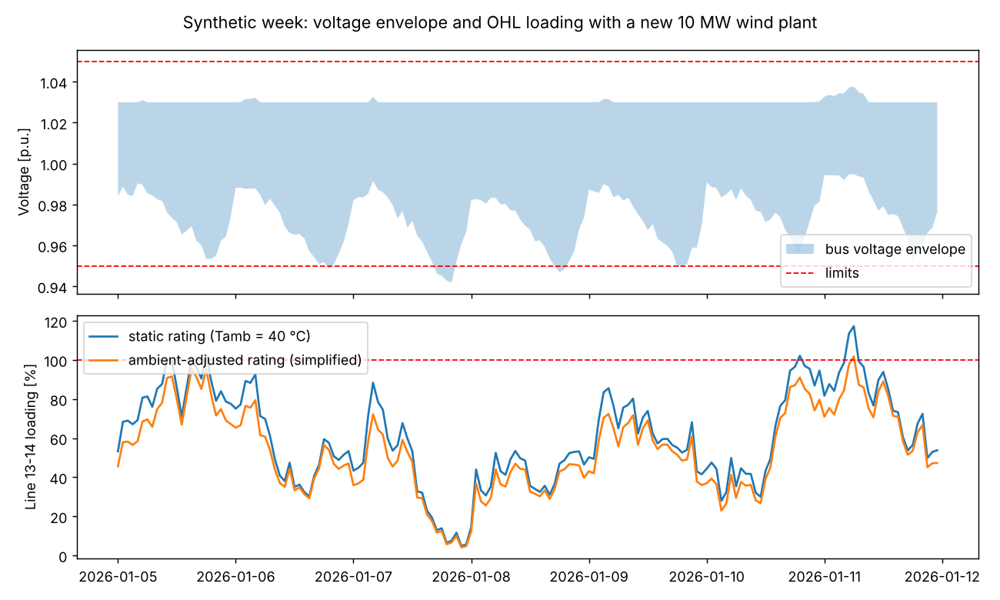
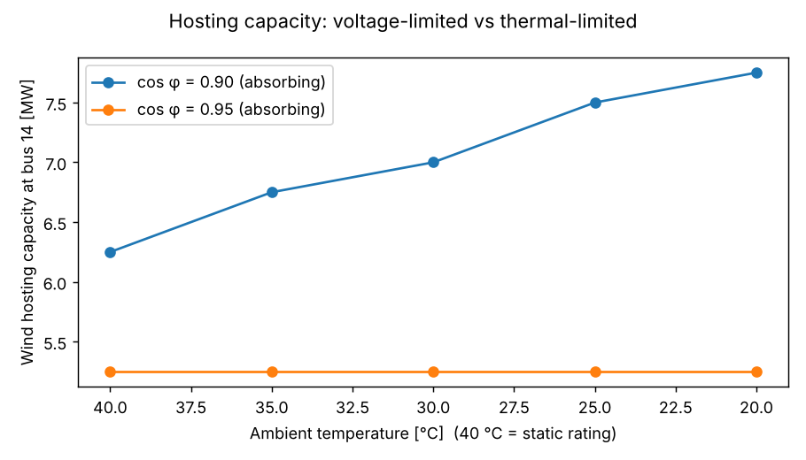

# pandapower-grid-study

A compact, reproducible power-system study on the **CIGRE MV benchmark network** (20 kV, two feeders, normally-open
tie points, PV + wind DER), built with [pandapower](https://www.pandapower.org). It bundles the routine analyses a
power-systems engineer runs on a grid model and ties them together with scripted, tested Python:

| # | Analysis | Module | Question answered |
|---|----------|--------|-------------------|
| 1 | AC power flow | `network.py` | Are voltages and loadings inside limits at peak demand? |
| 2 | Short circuit (IEC 60909, 3-ph, max/min) | `shortcircuit.py` | What fault levels do breakers and protection see, with inverter-based DER as current sources? |
| 3 | N-1 security + restoration | `contingency.py` | Which outages isolate load or violate limits, and can a tie-switch closure fix it? |
| 4 | Hourly time series (synthetic week) | `timeseries.py` | How do demand, PV, wind and ambient temperature move voltages and line loading? |
| 5 | Static vs ambient-adjusted line rating | `timeseries.py` | How much overload disappears if ampacity follows ambient temperature? |
| 6 | Wind hosting capacity at the end of an OHL feeder | `hosting.py` | How many MW can connect, and is the limit voltage or thermal? |

## Run

```bash
pip install -r requirements.txt
python run_study.py     # tables + figures + outputs/summary.md
python -m pytest        # 8 tests
```

## Results (as generated in `outputs/`)

- **Base case (peak demand, 44.7 MW):** losses 0.16 MW; 6 buses below 0.95 p.u. (min 0.947 p.u.) — the benchmark has no tap control, so this is a feature of the model, not a bug.
- **Short circuit:** 26.3 kA at the 110 kV source bus, 6.5 kA at the MV busbars, 1.0–1.5 kA at feeder ends (min case 11–18 % lower).
- **N-1:** 14 loaded elements assessed. Line outages isolate 0.1–4.3 MW; closing a tie restores all of it in every line case, but usually at the cost of voltage/thermal violations at peak. A transformer outage isolates 20–24 MW and no tie closure is feasible (the only path that reaches the isolated feeder does not converge).
- **Synthetic week with a new 10 MW wind plant at bus 14 (cos φ = 0.90):** the OHL section exceeds its static rating for 6 h (peak 117 %); with the simplified ambient-adjusted rating (+12.8 % mean ampacity) only 1 h remains (peak 102 %).
- **Hosting capacity at bus 14:** with cos φ = 0.95 the limit is **5.25 MW and set by overvoltage**, so a better thermal rating changes nothing. With cos φ = 0.90 the limit moves to **6.25 MW and becomes thermal**, and the ambient-adjusted rating raises it to 6.75 / 7.0 / 7.5 / 7.75 MW at 35 / 30 / 25 / 20 °C.

Take-away: extra thermal capacity only creates value once voltage is managed — which is why the two constraints are reported together.




## Assumptions and limitations (read before reusing the numbers)

- **Benchmark network, synthetic profiles.** Demand, PV, wind and temperature are seeded synthetic series, not measurements. Results illustrate a method; they are not a statement about any real grid.
- **Simplified thermal model.** Ambient-adjusted ampacity uses `I = I_static · sqrt((Tmax − Ta)/(Tmax − Tref))` with Tref = 40 °C and Tmax = 80 °C, applied to overhead lines only. It ignores wind cooling, solar heating and R(T); it is **not** IEEE 738 / CIGRE TB 601.
- **No tap changer or Volt-Var control** beyond a fixed power factor on the new plant; no protection coordination, no dynamics.
- **Short circuit:** DER modelled as current sources limited to 1.2 × rated current (`k` in `shortcircuit.py`); 3-phase faults only.
- **N-1 restoration** is a greedy single-switch search, not an optimal reconfiguration; N-1 is evaluated at peak demand.

## Layout

```
gridstudy/   config.py network.py shortcircuit.py contingency.py timeseries.py hosting.py report.py
tests/       test_study.py      # power balance, SC sanity, N-1 logic, profiles, rating, hosting
run_study.py                    # orchestrates everything, writes outputs/
outputs/                        # CSV tables, PNG figures, summary.md
```

## Possible extensions

- Replace the synthetic profiles with measured/ONS or utility data and add a forecasting step (time-series ML on wind and ambient temperature).
- Cross-check selected cases against a second tool (OpenDSS, PSS/E or DIgSILENT PowerFactory) to quantify model differences.
- Add OLTC / Volt-Var control and a proper IEEE 738 / CIGRE rating.
